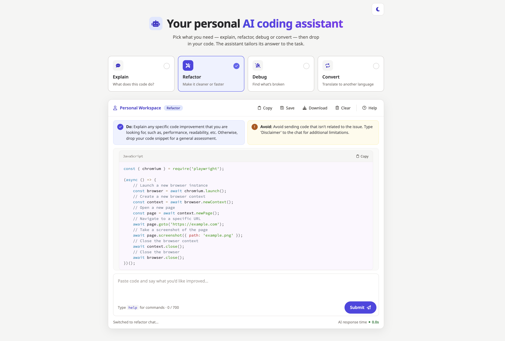
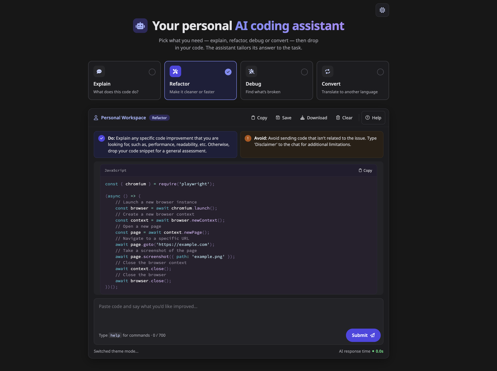

# AI Code Assistant

A coding chat that explains, refactors, debugs or converts a snippet in one click, with highlighted answers you can copy, save or download.

**[Live site](https://code.aniqa.dev)**

<!-- TODO: Replace both screenshots with the refreshed design once it's deployed (light and dark, ideally one with the help list open). These show the old layout. -->
<table>
  <tr>
    <td width="50%"><a href="https://code.aniqa.dev"></a></td>
    <td width="50%"><a href="https://code.aniqa.dev"></a></td>
  </tr>
</table>

## Tech

- HTML, JavaScript and Tailwind CSS, bundled with Webpack
- ChatGPT 3.5 through the SheCodes AI API
- Prism.js for syntax highlighting, with a tweaked [Laserwave](https://github.com/Jaredk3nt/laserwave) theme
- Font Awesome icons, Noto Sans and Source Code Pro
- PWA manifest, so it can be installed like an app

## Features

- Pick a mode (explain, refactor, debug or convert) and paste code with no prompt; each mode shows its own tips
- Answers type out as text and highlighted code, and every code block has its own Copy button
- Copy the latest snippet, save the chat for next time, download it as a styled HTML file or clear it
- Type `help` for a grouped list of built-in commands, then type one or tap it
- The status bar shows the last action and response time, green under 5 seconds and red over
- Light and dark themes; your theme, mode and saved chat are remembered in the browser

## Design

- The October 2026 refresh kept the layout, fonts and indigo/violet palette, and added mode descriptions, chat bubbles and a character counter
- The avoid tip is amber, not red, so it doesn't read like an error
- On phones the modes form a 2×2 grid, the tips stack and the toolbar goes icon-only
- The downloaded chat has its own stylesheet for screen and print

## Accessibility

- Modes are labeled radio buttons with a visible focus ring
- Toolbar buttons have screen reader labels for when they're icon-only
- Buttons are at least 44px tall, and pinch-zoom is allowed

## Project structure

- `src/scripts/ai/`: the request, API call and response timer
- `src/scripts/chat/`: input, commands, rendering, chat clicks, history and downloads
- `src/scripts/ui/`: theme, toolbars, mode buttons, typewriter and animations
- `src/data/`: commands and each mode's tips, as JSON
- `src/styles/`: Tailwind extras, the Prism theme and the download stylesheet
- `public/`: the Webpack build

## Key concepts

- **Going past the brief.** This started as a SheCodes course project with only the API provided; the modes, commands, toolbars, history and downloads are my additions.
- **Structured answers.** Each mode adds its own instruction to your snippet and asks for a fixed JSON shape of text and code blocks, so code renders with Prism instead of being parsed out of free text.
- **One listener for dynamic elements.** A single click handler on the chat covers every Copy and command button, including ones restored from history.
- **Keys at build time.** Webpack injects the API key from `.env` locally and from the host's environment in production, so it stays out of the repo.

## Setup

Requires Node and a SheCodes AI API key.

| Variable | Where to get it |
| --- | --- |
| `API_KEY` | Your SheCodes account |

```bash
git clone https://github.com/aniqatc/ai-assistant.git
cd ai-assistant
npm install
echo "API_KEY=your_key" > .env
npm start
```

Requests allow 1,000 characters and 300 go to the mode's context, so input is capped at 700. Icons come from a Font Awesome Kit, which only loads on domains allowed in its settings.

## Scripts

| Command | What it does |
| --- | --- |
| `npm start` | Dev server with `NODE_ENV=development` |
| `npm run build` | Production build into `public/` |

## Changelog

### October 2026

- Refreshed the design and made the layout work on phones
- Added per-block Copy buttons, a character counter and tappable commands

### January 2025

- Saved messages load instantly instead of replaying the typewriter effect

### December 2023

- Initial release

## License

MIT
